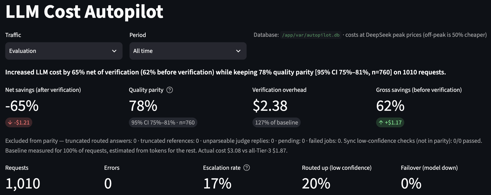
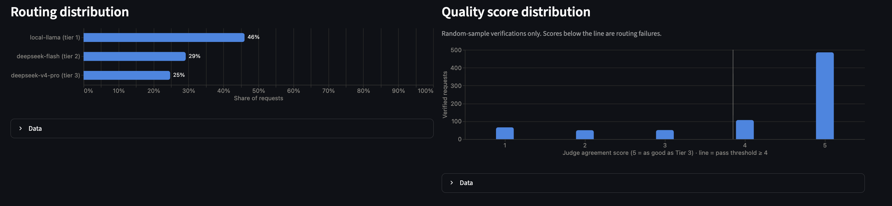
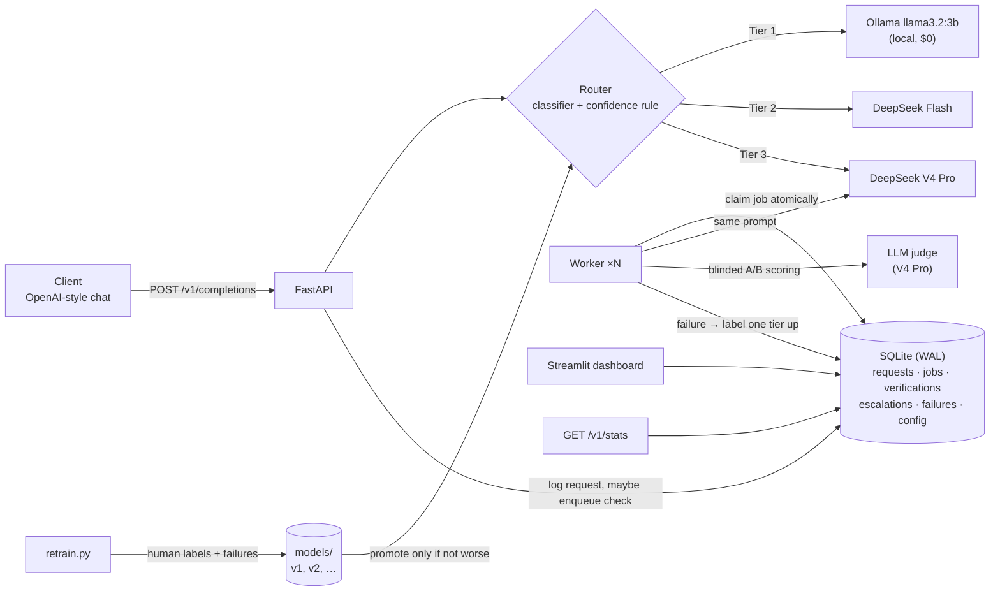

# LLM Cost Autopilot

**Cut LLM cost by 54% vs. sending everything to the top model (36% net after verifying a random 15% of answers), while keeping 85% quality parity (95% CI 80%–89%) on 300 requests.**

A routing layer that sits in front of three LLMs, classifies each request's complexity, sends it
to the cheapest model that can handle it, verifies a random sample of those decisions against
the top model in the background, and turns confirmed routing failures into new training data.

<!-- results:start -->

| Load test (classifier v3) | Result |
|---|---|
| Requests (held-out Dolly pool) | 300 answered, 0 failed |
| Routing | deepseek-flash 47% · deepseek-v4-pro 29% · local-llama 24% |
| Everything on Tier 3 (baseline) | $0.51 (all measured: real Tier-3 cost for every request) |
| Autopilot answering cost | $0.23 → **gross savings 54%** |
| Quality parity (judge: as good as Tier 3) | **85.0%** — 95% CI 79.7%–89.2%, n=214; 0 excluded and reported |
| Verification, every downgraded answer (load test) | $0.64 → net savings in this run -71% |
| Projected net savings, 15% verified (production) | **36%** |
| Escalation rate (failures logged) | 10.7% |
| Routed up for low confidence | 18.0% |
| Latency P50 / P95 by tier | T1 3.9s / 13.9s · T2 2.5s / 6.3s · T3 5.6s / 21.3s |
| Truncated at max_tokens (excluded from parity) | T1 0.0% · T2 0.0% · T3 0.0% |
| Load-test bill | $0.88 at peak prices · $0.44 at off-peak prices |

Full report: [`data/loadtest_report_v3.md`](data/loadtest_report_v3.md) · raw numbers: [`data/loadtest_report_v3.json`](data/loadtest_report_v3.json)

<!-- results:end -->

**Live demo** — a read-only Streamlit page with the real load-test results and a *Try the router* box
(the trained classifier picks a model for any prompt you type; no LLM is called, no API key needed):
run it locally with `make demo`, or deploy `streamlit_app.py` on [Streamlit Community Cloud](https://share.streamlit.io).

> Every cost is at DeepSeek **peak** prices (a conservative upper bound; off-peak is 50% cheaper).
> Savings are **never** reported without quality parity and the cost of verification next to them.

| Dashboard — honest metrics panel | Routing & quality |
|---|---|
|  |  |

*Screenshots are from the first load test (classifier v2, 1,000 prompts + a 10-prompt trial run).
In a load test **every** downgraded answer is verified, so net savings there are negative by design;
the headline figures are projected to the production verification rate of 15%.*

---

## What the load tests taught me

**Run 1 — classifier v2, 1,000 prompts:** 62% gross savings (43% projected net), **78% quality
parity** (95% CI 75–81%). The overall number hid two very different models:

| Answered by (run 1) | Quality parity (95% CI) | Verified |
|---|---|---|
| DeepSeek Flash (Tier 2) | **97.3%** (95–99%) | 291 |
| Local llama 3B (Tier 1) | **65.4%** (61–70%) | 460 |
| ↳ answer was in the provided text | 76.3% (69–83%) | 139 |
| ↳ answering from memory (no text given) | 60.7% (55–66%) | 321 |
| Requests routed up for low confidence | 99.2% | 128 |

- **The router did what it was taught; the rubric was too optimistic.** 153 of the 167 failures
  were short fact questions answered from memory ("Who directed the most episodes of season five
  of Game of Thrones?"). The rubric put those in Tier 1, but a 3B model doesn't hold that knowledge.
- **The safeguard held.** Retraining on the 167 failures taught "fact questions → Tier 2", which
  contradicted the human-labeled test set, so the promotion rule refused it (67% / 82% vs 79% / 91%).
  A model that disagrees with the reference labels never goes live by accident — the fix had to be
  a deliberate **policy** change.

**The fix (round 3):** rubric rule 2 became "fact question answered from memory → Tier 2"
(`rules-v3`). Only the 84 affected labels were re-checked, old answers hidden; 69 moved up a tier.
Classifier v3 went live (test accuracy 78% vs v2's 63% on the updated labels; under-routing 22% → 10%).

**Run 2 — same first 300 prompts, v2 vs v3** ([`data/v2_vs_v3_comparison.json`](data/v2_vs_v3_comparison.json)):

| Same 300 prompts | v2 (before) | **v3 (after)** |
|---|---|---|
| Sent to local llama 3B | 48% | **24%** |
| Quality parity (95% CI) | 76.7% (71–82%) | **85.0% (80–89%)** |
| Routing failures found | 54 | **32** |
| Gross savings | 66.7% | 54.3% |
| Projected net savings (15% verified) | 46.4% | 35.5% |

- **The trade-off is explicit:** about 12 points of savings bought about 8 points of quality.
  Where to sit on that curve is a product decision; the system makes it measurable.
- **My projection was too optimistic** (I estimated ~93% parity; measured 85%). The memory questions
  moved to Flash as intended — 71 of the 72 requests still sent to llama now include a text passage —
  but llama's parity on what it still gets did not change (65%). The remaining gap is the 3B model's
  reading comprehension, not the routing policy.
- **Feedback loop, round 2:** retraining v3's labels plus the 167 failures (v5) caught 100% of
  Tier-3 prompts but scored one test prompt lower on accuracy (76% vs 78%), so the not-worse rule
  kept v3. Moving the goalposts after seeing a result would defeat the rule; a tolerance would have
  to be agreed in advance.
- **Low confidence is a good signal for "route up", not for "this will fail".** In run 1,
  routed-up requests reached 99% parity, but among the rest parity was similar at confidence
  0.50–0.65 (72%) and ≥ 0.65 (75%).
- **Verification is the expensive part.** Checking every downgraded answer costs more than serving
  everything with Tier 3 (run 1: $2.36 vs $1.86). At 15% the same checks cost about a seventh of
  that, which is where the projected net savings come from.

## Contents

- [What the load tests taught me](#what-the-load-tests-taught-me)
- [How it works](#how-it-works)
- [Routing logic](#routing-logic)
- [Verification and the feedback loop](#verification-and-the-feedback-loop)
- [The classifier: from 55% to 78%](#the-classifier-from-55-to-78)
- [Honest metrics](#honest-metrics)
- [Setup](#setup)
- [API](#api)
- [Architecture decisions](#architecture-decisions)
- [Limitations and next steps](#limitations-and-next-steps)
- [Project layout](#project-layout)
- [Data and licensing](#data-and-licensing)

## How it works



| Tier | Model | Used for | Price (in / out per 1M tokens, peak) |
|---|---|---|---|
| 1 | `llama3.2:3b` via Ollama (local) | extraction, reformatting, short fact questions | $0 / $0 |
| 2 | DeepSeek `deepseek-flash`, thinking off | summaries, classification, structured overviews | $0.30 / $1.20 |
| 3 | DeepSeek `deepseek-v4-pro`, thinking configurable | reasoning, advice, creative writing — and the verification reference | $1.32 / $3.96 |

All three are called through the official `openai` SDK with different base URLs. DeepSeek turns
thinking mode **on** by default, so the client always sends the toggle explicitly.

## Routing logic

1. **Classify** the latest user message with the current classifier (TF-IDF of the instruction +
   hand-crafted features, random forest). It returns a tier, a probability, and a task type.
2. **Route up when unsure.** If the top probability is below the threshold in
   [`config/routing.yaml`](config/routing.yaml) (0.50), go one tier up. Paying a bit more beats
   a wrong answer.
3. **Look up the model** for the tier in `routing.yaml` (editable, also changeable at runtime via
   `PUT /v1/routing-config`, validated and logged).
4. **Fail safe.** If the routed model is down, fail over to the next tier up. If the classifier
   itself fails, use the fallback tier (3).
5. **Explain.** Every response carries `autopilot.reason`, e.g.
   `classifier predicted tier 1 (p=0.36); below confidence threshold 0.50 → routed up to tier 2`.

## Verification and the feedback loop

- **Sampling.** In normal mode a random **15%** of downgraded requests are verified; in evaluation
  mode (load tests) **100%**. Requests already answered by Tier 3 have nothing to compare against.
- **Reference + judge.** A worker process sends the same messages to Tier 3, then asks an
  LLM judge to score both answers 1–5 against a task-specific criterion from
  [`config/quality.yaml`](config/quality.yaml). The judge sees "Answer A" and "Answer B" in random
  order and is never told which came from the expensive model.
  `agreement = 5 − max(0, reference − routed)`; below 4 is a **routing failure**.
- **Escalation.** `async` (default): respond immediately, log failures. `sync`: for
  low-confidence requests, check against Tier 3 *before* responding and return the Tier-3 answer
  if the routed one fails. Every escalation is logged with original model, escalated model, cost
  delta, and quality gap.
- **Exclusions are counted, not hidden.** Answers cut off at `max_tokens` (routed or reference)
  and unparseable judge replies are left out of parity and shown per tier.
- **Feedback loop.** Each confirmed failure becomes a training example labeled one tier up.
  [`scripts/retrain.py`](scripts/retrain.py) retrains on human labels + failures, scores the
  candidate and the current model on the **same frozen test set**, and promotes only if Tier-3
  recall and accuracy are not worse. Failure prompts that appear in the test set or were already
  labeled by a human are dropped. Every run is appended to `models/retrain_log.jsonl`.
- **Queue without Redis.** Jobs live in a SQLite table. Workers claim them with one
  `UPDATE … RETURNING` inside an `IMMEDIATE` transaction, so any number of workers can run side by
  side (the load test used three); failed jobs retry with backoff, and jobs from a crashed worker
  are reclaimed after a visibility timeout.

## The classifier: from 55% to 78%

The most useful lesson of the project came from the data, not the model.

| | v1 (round-1 labels) | v2 (`rules-v2`) | **v3 (`rules-v3`, live)** |
|---|---|---|---|
| Labels | 215, hand-labeled from Dolly 15k | 296, re-labeled with a written first-match rubric | 290; memory-only fact questions re-checked |
| Cross-validated accuracy | 55% ± 5% | 71% ± 6% | **76% ± 7%** |
| Held-out test accuracy (n≈41) | 65% | 79% | **78%** |
| Held-out Tier-3 recall | 58% | 91% | **91%** |
| Under-routing (hard prompt → weaker model) | 21% | 7% | **10%** |

*Each column is scored against its own labels; on the v3 labels, v2 scores 63% — the comparison
the promotion rule used.*

- **v1 missed the 80% target**, and changing the model didn't help: eight variants (regularisation,
  feature subsets, random forest) all scored 43–52% in cross-validation, against a 40%
  majority-class baseline. Sentence embeddings (`nomic-embed-text` via Ollama) didn't help either.
- **Diagnosis:** for each training prompt, its most similar prompt (by embedding) had the same tier
  only **36%** of the time — chance was 34%. Near-identical questions had different tiers.
  The tier definitions left common cases (e.g. a fact question with no text given) undefined.
- **Fix:** a written, first-match rubric (in [`schemas.py`](src/autopilot/dataset/schemas.py)),
  shown on screen while re-labeling, with the old labels hidden. Self-agreement with round 1 was
  only **48%** — the rubric changed many decisions. Neighbour consistency rose to **57%** (chance 39%),
  and accuracy followed, with no change to the model.
- **Protocol:** a stratified test set frozen once (`data/test_split.json`); model selection on
  cross-validation only; the test set scored once per candidate. With ~42 test prompts, each prompt
  is ~2.4 points, so cross-validation (71%) is the more reliable estimate.

## Honest metrics

All numbers come from one module, [`analytics/metrics.py`](src/autopilot/analytics/metrics.py),
used by the dashboard, `GET /v1/stats` and the load-test report.

| Metric | Definition |
|---|---|
| All-Tier-3 baseline | Real Tier-3 cost where measured (served by or verified against Tier 3); otherwise estimated from token counts. The measured share is reported. |
| Gross savings | `1 − answering cost / baseline` |
| Net savings | `1 − (answering + verification) / baseline` |
| Quality parity | Share of **randomly sampled** downgraded answers the judge rated as good as Tier 3, with a 95% Wilson interval. Sync checks (low-confidence only) are reported separately because they are a biased sample. |
| Exclusions | Truncated routed answers, truncated references, unparseable judge replies, failed jobs — counted and shown. |

The headline sentence refuses to state savings when quality has not been measured, and the
dashboard hides the savings tiles until it has.

## Setup

**Prerequisites:** Python 3.11+, [Ollama](https://ollama.com) with `llama3.2:3b`, a
[DeepSeek API key](https://platform.deepseek.com/api_keys), and Docker (for the containerised stack).

```bash
make install                      # virtualenv + all dependencies
cp .env.example .env              # add DEEPSEEK_API_KEY
ollama pull llama3.2:3b
make test                         # full suite, every LLM call mocked
```

**Run with Docker** (api :8000, worker, dashboard :8501; Ollama stays on the host):

```bash
make up                           # normal mode, 15% verified
make up-eval                      # evaluation mode, 100% verified (load tests)
docker compose up -d --scale worker=3 worker   # more verification throughput
make loadtest LIMIT=1000          # prints peak/off-peak status + cost estimate, asks first
make down
```

**Or locally:** `make api`, `make worker`, `make dashboard`.

**Rebuild the data and model from scratch:** `make sample` → `make relabel` → `make train`
→ (later) `make retrain`. `make help` lists every target.

## API

Interactive docs at `http://localhost:8000/docs`.

```bash
curl -s localhost:8000/v1/completions -H 'Content-Type: application/json' \
  -d '{"messages":[{"role":"user","content":"Which of these are fruits: apple, carrot, banana?"}]}'
```

```jsonc
{
  "model": "deepseek-flash",
  "choices": [{"message": {"role": "assistant", "content": "apple, banana"}, "finish_reason": "stop"}],
  "usage": {"prompt_tokens": 27, "completion_tokens": 3, "total_tokens": 30},
  "autopilot": {
    "chosen_model": "deepseek-flash", "predicted_tier": 2, "classifier_confidence": 0.62,
    "routed_up": false, "reason": "classifier predicted tier 2 (p=0.62)",
    "cost_usd": 0.0000117, "verification_status": "not_sampled"
  }
}
```

| Endpoint | Purpose |
|---|---|
| `POST /v1/completions` | OpenAI-style chat; `model` must be omitted or `"auto"`. |
| `GET /v1/models` | Models, prices, which tiers they serve, peak/off-peak status. |
| `GET /v1/stats` | Savings + quality parity + overhead + escalations (`mode`, `since`, `since_hours` filters). |
| `GET/PUT /v1/routing-config` | Inspect / change the tier → model mapping; validated, logged, survives restarts. |
| `GET /health` | Liveness, classifier version, queue counts. |

Errors share one shape: `{"error": {"type", "message", "details"}}` — 422 invalid input, 502 all
tiers failed, 503 provider not configured. Set `AUTOPILOT_API_KEY` to require a bearer token.

## Architecture decisions

**Why hand-labeled tiers?** No dataset says which prompts a 3B local model can handle. Dolly's
categories were used only to stratify sampling and were never shown while labeling, so they could
not anchor the labels. Labeling also exposed the real problem (an under-specified rubric) that a
borrowed label set would have hidden.

**Why route up on low confidence?** The two errors are not equal. Sending an easy prompt to Tier 3
wastes a fraction of a cent; sending a hard prompt to a 3B model gives the user a confidently wrong
answer (in Phase 1, llama answered a pricing puzzle with "$60" instead of "$57"). When the
classifier is unsure, the safe direction is up.

**Why Tier-3 recall over raw accuracy?** Same asymmetry: model selection maximises cross-validated
Tier-3 recall subject to an accuracy floor (so "always say Tier 3" can't win), classes are
weighted, and promotion requires Tier-3 recall not to drop.

**Why verification sampling?** Checking one answer costs a Tier-3 answer plus a judge call — more
than serving the request with Tier 3 in the first place. Verifying everything (evaluation mode)
makes net savings negative by construction; verifying a random 15% keeps a statistically useful
quality signal at a fraction of the cost. The sample is random so parity is unbiased.

**Why is cost always reported with quality?** Routing everything to the cheapest model maximises
"savings" and destroys quality. A savings number without parity, overhead and sample size is
meaningless, so the code (not just the UI) refuses to produce one.

**Smaller ones:** a SQLite queue instead of Redis (one less service; atomic claims make it safe
with many workers) · SQLite on a Docker volume, not a macOS bind mount (WAL needs reliable locks and
shared memory) · a blinded judge with separate scores (reduces deference to the "reference") ·
pinned scikit-learn (pickles are version-sensitive) · scripts are thin, logic lives in the package
(so every flow is tested with fake LLMs).

## Limitations and next steps

- **Judge self-preference:** the judge is the same model family as Tier 3. Blinding helps; a
  different-family judge or periodic human spot checks would help more.
- **Small labeled set:** 296 labels and a 42-prompt test set — test accuracy moves ~2.4 points per
  prompt. The feedback loop adds examples over time; more human labels would help most.
- **One labeler:** the rubric made labels consistent, but they are still one person's judgement.
- **Tier 1 is the weak link:** llama 3B reaches ~65% parity even when the answer is in the provided
  text. A stronger local model (e.g. an 8B), or routing long passages to Flash, is the next lever —
  routing policy alone can't fix it. Laptop latency (P50 several seconds) is also the price of $0.
- **Next:** calibrate classifier probabilities, tune the route-up threshold from verification data,
  per-tenant budgets, streaming responses.

## Project layout

```
config/            models.yaml (prices) · routing.yaml · quality.yaml · settings.yaml
src/autopilot/
  llm/             one async send_request for every provider; retries, concurrency, pricing
  dataset/         Dolly sampling, labeling tool, rubric
  classifier/      features, training/CV, registry, promotion rule, feedback loop
  routing/         tier → model config, router
  verification/    judge, quality rules, verifier, sampling, worker
  storage/         SQLite schema + repository (incl. the job queue)
  analytics/       honest metrics (one definition for everything)
  api/             FastAPI app, schemas, error handling
  dashboard/       Streamlit app + Altair charts
scripts/           thin CLIs: smoke_test, sample/label, train/retrain, worker, ask, loadtest
tests/             pytest; every LLM call faked
```

## Data and licensing

Prompts are sampled from [Databricks Dolly 15k](https://huggingface.co/datasets/databricks/databricks-dolly-15k),
licensed under **CC BY-SA 3.0**. `data/candidates.csv` and `data/loadtest_prompts.jsonl` are
derived from it (instruction + context) and are shared under the same license. Tier and task-type
labels in `data/labeled_prompts_v2.jsonl` are hand-labeled for this project.
